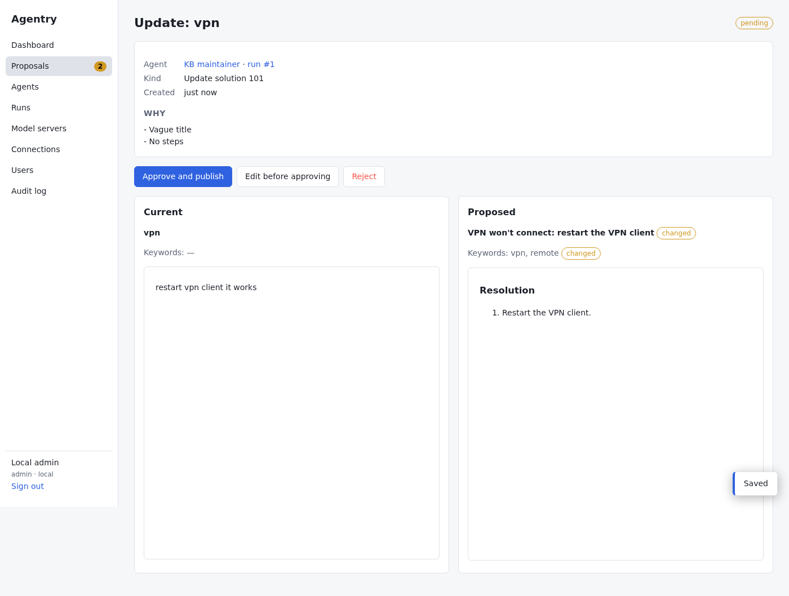

# Agentry

Web app for running AI agents against a local GPU server. Agents propose changes; people approve them before anything is published (or an agent can be set to publish directly).

First agent: **ServiceDesk Plus Solutions**
- **Review**: reads existing Solution articles, proposes rewrites for unclear or badly structured ones.
- **Gaps**: groups recently resolved tickets that no Solution covers (embeddings) and drafts a new Solution from how they were resolved.



## Features

- Model servers: Ollama or any OpenAI-compatible server (vLLM, llama.cpp, LM Studio). Health, installed models, what's loaded in VRAM.
- Agents: schedule (every N minutes) or run by hand, live run log, stop button.
- Proposals: side-by-side current vs proposed, edit before approving, reject. Updates are refused if the Solution changed in ServiceDesk Plus after the proposal was made.
- Sign-in: OpenID Connect (Entra ID, Authentik, Keycloak, Google, …) with group → role mapping, plus an optional local admin.
- Roles: admin (everything), reviewer (approve/reject), viewer (read-only).
- API keys encrypted at rest. Audit log of sign-ins, config changes, and approvals.
- Model output is stripped to formatting-only HTML before it's stored or sent to ServiceDesk Plus.

## Run

```bash
cp .env.example .env    # set AGENTRY_ADMIN_PASSWORD and/or OIDC_*
docker compose up -d --build
```

Open http://<host>:8090, then:
1. **Model servers** → add the GPU server (e.g. `http://10.0.20.50:11434`, kind Ollama).
2. **Connections** → add ServiceDesk Plus, **Test**.
3. **Agents** → New agent → ServiceDesk Plus Solutions → Save → **Test setup** → **Run now**.
4. **Proposals** → review.

Start in Review mode with a small `Solutions per run`. Turn on the schedule once the proposals look right.

For what to run on the GPU server, see [docs/models.md](docs/models.md).

## SSO

Redirect URI to register at the provider: `<AGENTRY_PUBLIC_URL>/auth/oidc/callback`

**Entra ID**
1. App registrations → New → Web, redirect URI as above.
2. Certificates & secrets → new client secret.
3. Token configuration → Add groups claim → Security groups (ID token). Entra sends group **object IDs**; put those in `OIDC_*_GROUPS`.
4. `.env`: `OIDC_ISSUER=https://login.microsoftonline.com/<tenant-id>/v2.0`, client ID, secret.

**Authentik**: OAuth2/OpenID provider + application. Issuer is `https://<authentik>/application/o/<slug>/`. Groups come in the `groups` claim by default.

Role from groups is set at every sign-in. Without group mapping, new SSO users get `OIDC_DEFAULT_ROLE` and an admin changes roles on the Users page; the first SSO user on an install with no admin becomes admin.

Once SSO works, set `AGENTRY_LOCAL_LOGIN=false`.

## ServiceDesk Plus

- **On-premises**: technician API key (profile → Generate API Key). The agent acts as that technician: it needs to view requests and add/edit Solutions. A dedicated technician account (e.g. "KB Agent") keeps the history clear.
- **Cloud**: Zoho OAuth self client with scopes `SDPOnDemand.solutions.ALL,SDPOnDemand.requests.READ`; enter client ID, secret, refresh token, and the accounts URL for your data center.

Uses REST API v3: `GET/PUT/POST /api/v3/solutions`, `GET /api/v3/requests`.

## HTTPS

Put it behind a reverse proxy (Caddy, Nginx Proxy Manager, Traefik) and set `AGENTRY_PUBLIC_URL=https://…`, `AGENTRY_SECURE_COOKIES=true`, and `AGENTRY_TRUSTED_PROXIES` to the proxy's IP.

## Develop

```bash
python3.12 -m venv .venv && .venv/bin/pip install -r requirements-dev.txt
AGENTRY_ADMIN_PASSWORD=dev AGENTRY_DATA=./data .venv/bin/python -m agentry   # http://localhost:8090
.venv/bin/python -m pytest -q
```

Tests run the agent end to end against an in-memory ServiceDesk Plus and Ollama (`tests/fakes.py`).

### Adding an agent type

Subclass `AgentType` in `agentry/agents/`, declare `fields` (the settings form is built from them), implement `run(ctx)` and `apply(proposal, config)`, and register it in `TYPES` in `agentry/agents/__init__.py`. Use `ctx.propose(...)` for changes so they go through review.

## Status

v0.1.0. Not yet tested against a real ServiceDesk Plus instance or a real GPU model; field names for request resolutions and solution timestamps may need adjusting per SDP build.
